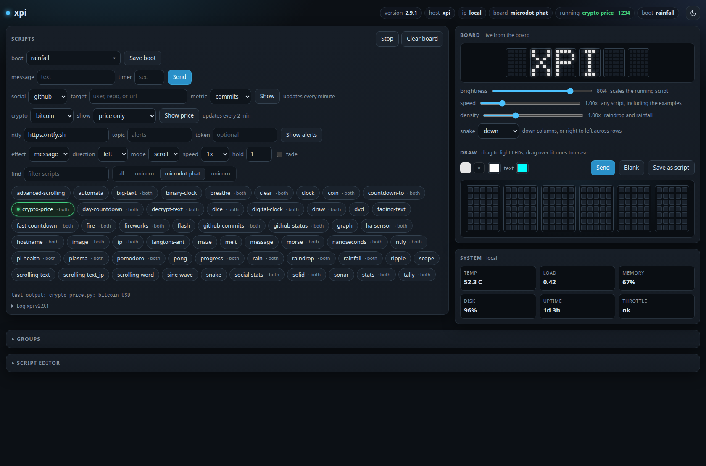

# xpi display webserver

Controls Pimoroni microdot-phat and Unicorn HAT/pHAT displays from a web page
on a Raspberry Pi.



## Install

On the Pi:

```sh
git clone https://github.com/CFBR/xpi
cd xpi
sudo ./install.sh
```

The installer prints the page address, usually `http://<hostname>.local/` and
`http://<pi-ip>/`. Open it and pick a script.

To install from your laptop instead, copy the folder over and run the installer
on the Pi:

```sh
rsync -av --exclude .git xpi/ pi@raspberrypi.local:/tmp/xpi/
ssh pi@raspberrypi.local 'sudo /tmp/xpi/install.sh'
```

The service runs as root because the Unicorn LED driver needs `/dev/mem`. Run
`journalctl -fu xpi` to see its logs.

## Control page

Every button maps to a URL, so the address bar shows what you did. Browsers get
the page and curl gets JSON.

```
http://<pi-ip>/?action=switch&script=rainbow     # run or reset a script
```

| Command | What it does |
|---|---|
| `?action=update&script=message&message=hello` | Send text and restart `message` |
| `?action=update&seconds=15&script=timer` | Start a countdown |
| `?action=update&message=hi` | No script: the running script picks it up without a restart |
| `?action=update&brightness=0.4` | Set LED brightness, 0 to 1. Unicorn boards only |
| `?action=update&color=red` | Set text or fill color, by name or `#RRGGBB` |
| `?action=switch&script=clock&arg=x` | Stop the current script and run `clock` with positional args |
| `?action=stop` | Kill the script. Its last frame stays on the board |
| `?action=clear` | Kill the script and blank the board |
| `?action=boot&script=clock` | Set the boot script. Leave out `script` or use `none` to unset it |
| `?action=playlist&scripts=rainbow,clock&seconds=60` | Rotate scripts every N seconds. Empty `scripts` clears it |
| `?action=backup` | JSON of config, state and every script |
| `?action=restore` (POST the backup JSON) | Write the scripts and config back |
| `?action=savedrawing&script=NAME` (POST the pixels JSON) | Save the draw panel as a script |
| `?action=status` | Running, pid, boot, scripts, boards, ip, revision, log |

Quote the whole URL because `?` and `&` are shell metacharacters. Repeat `arg=`
to pass several positional arguments.

The page also draws. Drag across the LED grid to light pixels and drag over lit
ones to erase; Send paints the board. A preview above the grid shows what the
board is displaying. The page also has a brightness slider, a light/dark toggle,
and an editor that loads, saves, uploads and deletes files in `scripts/`.

## state.json

```json
{"message": "...", "seconds": 15, "brightness": 0.5, "speed": 1.0, "revision": 17}
```

`/action=update` increments `revision`. Scripts that poll `revision()` from
`scripts/_xpi_state.py` read new `message`, `seconds`, `brightness` and `color`
values without a restart.

`brightness` scales whatever the running script sets, on either board. `speed`
scales `time.sleep` for any script, including the Pimoroni examples: `2.0` runs
at double speed, `0.5` at half. Both apply without a restart.

## Boards

Each script is tagged by the folder it lives in or by what it imports:
`microdot-phat`, `unicorn-hat`, `unicorn phat`, or `both`. A microdot script
does not run on a Unicorn board, and a Unicorn script does not run on a
microdot-phat. The page filters scripts by board tab and opens the tab for the
board it detected.

Detection is exact for the microdot-phat, whose I2C chips answer, and for the
Unicorn HAT, which has an EEPROM. A Unicorn pHAT has no EEPROM, so the page
labels it `inferred`.

## Scripts

`scripts/` holds the xpi scripts: `message`, `timer`, `unicorn_message`,
`hostname`, `ip`, `digital-clock`, `day-countdown`, `fast-countdown`,
`nanoseconds`, `github-commits`, `stats`, `countdown-to`, `tally`, `progress`,
`rain`, `plasma`, `fire`, `breathe`, `morse`, `pomodoro`, `big-text`, `dice`,
`coin`, `draw`, `solid` and `clear`.

The same folder holds every script from the archived Pimoroni example sets,
under `microdot-phat/` and `unicorn-hat/`. That is 12 microdot-phat examples
and 28 Unicorn HAT/pHAT examples. `scripts/README.md` lists them and their
optional dependencies.

To add a script, drag a `.py` file onto the page. It saves to
`/opt/xpi/scripts/` and appears in the list.

## Token

Set a `token` in `config.json` to protect `savescript`, `delscript`, `boot` and
`stop`:

```json
{"boot": "clock", "token": "your-secret"}
```

Send it as `?token=...` or in an `X-XPI-Token` header. The page asks once and
keeps it in the browser. Leave it null for an open LAN box.

## Updating

On the Pi, from the clone:

```sh
./update.sh
```

That pulls `main` and runs the installer, which keeps `config.json` and any
scripts saved from the page.

## Credits

The display libraries in `vendor/` and the examples in `scripts/` come from
Pimoroni Ltd under the MIT license:
[microdot-phat](https://github.com/pimoroni/microdot-phat) and
[unicorn-hat](https://github.com/pimoroni/unicorn-hat). The license texts are in
`LICENSES/`. xpi itself is MIT, see `LICENSE`.
